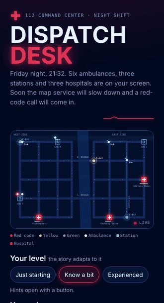
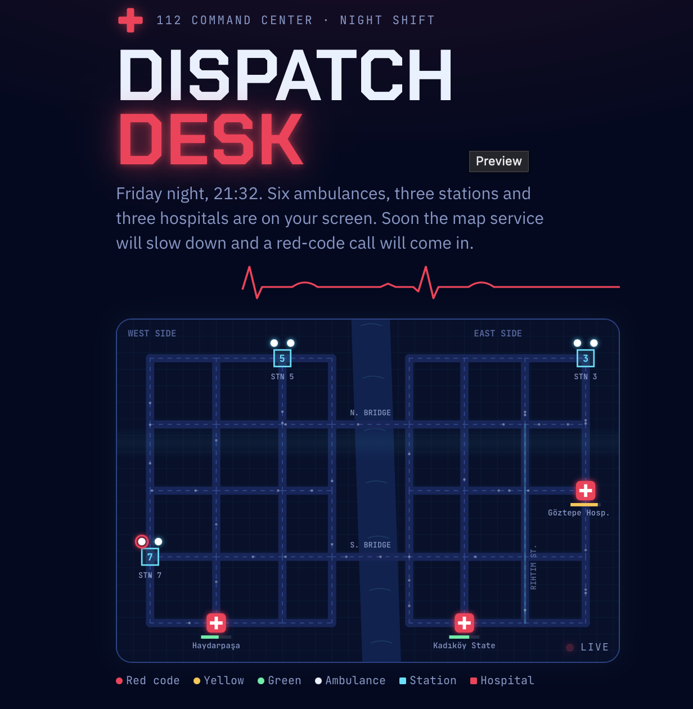
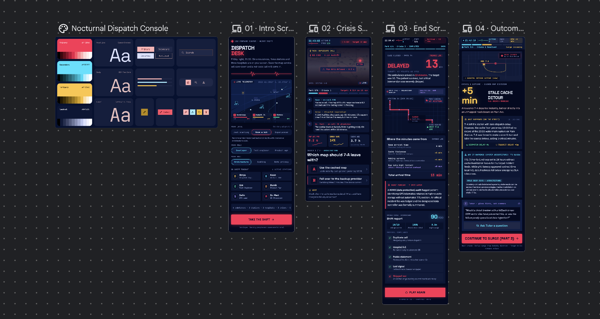

<p align="center">
  
</p>

<p align="center">
  <a href="https://ai.studio/apps/c92c0966-9d92-45c2-bc3c-554fd44dcc52"></a>
  <a href="https://stitch.withgoogle.com/projects/9828801172742432808"></a>
  <a href="eval/REPORT.md"></a>
  <a href="cypress/"></a>
</p>

# SE Primer: Dispatch Desk

**A mobile story game that teaches software engineering decisions through an ambulance dispatch crisis.**
YZM301 · *SE Primer* assignment · Samsun University, Software Engineering

It is Friday night in a fictional city. You are the on-call engineer at an emergency dispatch center. The map service slows down, the call queue grows and a red-code patient is waiting. Every technical decision you make (architecture, scaling, data privacy) turns into minutes on the ambulance's arrival time. A Socratic tutor helps you think about each decision but never tells you the answer.

<table>
  <tr>
    <td align="center" width="38%"><br><sub>Live dispatch → Crisis 1 → outcome</sub></td>
    <td align="center"><br><sub>Intro screen with the live city map</sub></td>
  </tr>
</table>

## Links

| | |
|---|---|
| **Play it (Google AI Studio)** | https://ai.studio/apps/c92c0966-9d92-45c2-bc3c-554fd44dcc52 |
| **Demo video (60 s)** | *https://youtube.com/shorts/un7lmACvZM4* |
| **Design (Google Stitch)** | https://stitch.withgoogle.com/projects/9828801172742432808 |
| **Specification** | [`spec.md`](spec.md) |

---

## Contents

1. [The idea](#the-idea)
2. [How a shift plays out](#how-a-shift-plays-out)
3. [The three decisions](#the-three-decisions)
4. [Live dispatch and field tasks](#live-dispatch-and-field-tasks)
5. [Personalization](#personalization)
6. [The Socratic tutor](#the-socratic-tutor)
7. [Tutor evaluation](#tutor-evaluation)
8. [Design](#design)
9. [How it is built](#how-it-is-built)
10. [Running and testing](#running-and-testing)
11. [Repository layout](#repository-layout)
12. [Product decisions: what we did not build](#product-decisions-what-we-did-not-build)
13. [Known limitations](#known-limitations)
14. [Assignment checklist](#assignment-checklist)

---

## The idea

Students usually meet trade-offs like *cache vs. fresh data* or *scale out vs. prioritize* as textbook definitions, with no pressure and no visible consequence. Dispatch Desk puts those trade-offs into a situation where time matters. Every choice is a **state transition** with a measurable effect, and every ending is an **acceptance criterion** you can test.

The game follows the assignment brief: one health scenario, three decisions, two endings. Each decision is followed by *what happened* and *why it happened*. The game adapts to the player's level, role and goal, and the AI tutor gives hints, not answers.

## How a shift plays out

A shift has six parts. Three live dispatch phases alternate with three crisis decisions:

| # | Part | What you do |
|---|---|---|
| 1 | **Handover** (21:32) | Assign crews to incoming calls. Handle a duplicate call. |
| 2 | **Crisis 1 · Architecture** | The map API slows to 8.2 s just as red-code call K-114 arrives. Pick which map ambulance 7-A uses. |
| 3 | **Surge** (21:42) | Friday rush: more calls than free crews. A hospital fills up and a journalist calls. |
| 4 | **Crisis 2 · Scaling** | CPU at 96%, 19 calls queued, K-114 waiting in 9th place. Prioritize or add servers? |
| 5 | **Field** (21:49) | 7-A drives to K-114 on the map. A crew goes silent and a skipped CI test surfaces. |
| 6 | **Crisis 3 · Data and privacy** | The case closes. Decide what happens to the patient's location trail. |

The **end screen** shows the arrival minute, a breakdown of where each minute came from, an epilog set one week later (a KVKK data protection audit), and a shift report scored out of 100.

## The three decisions

The red-code patient has a **10-minute target**. With no problems the ambulance would arrive in **4 minutes**. Decisions 1 and 2 add minutes and decision 3 decides the epilog.

| Decision | Option A | Option B |
|---|---|---|
| **1 · Architecture**: which map? | **Use the cached map**: instant, but stale. Route goes through a street that closed yesterday. **+5 min** | **Fail over to backup provider**: 3-minute switch, current data. **+3 min** |
| **2 · Scaling**: load is rising | **Prioritize the queue**: red codes jump to the front, others wait a bit. **+0 min** | **Add servers**: 4-minute cold start, queue order unchanged. **+4 min** |
| **3 · Privacy**: the location trail | **Keep it limited to its purpose**: reduce to neighborhood level after the case closes. | **Keep raw data forever**: share the full trail with analytics. |

### All eight paths

| Path | Choices | Arrival | Ending | Audit one week later |
|---|---|---|---|---|
| P1 | A · A · A | 9 min | **On time** | Passed |
| P2 | A · A · B | 9 min | **On time** | Violation found |
| P3 | A · B · A | 13 min | **Delayed** | Passed |
| P4 | A · B · B | 13 min | **Delayed** | Violation found |
| P5 | B · A · A | 7 min | **On time** | Passed |
| P6 | B · A · B | 7 min | **On time** | Violation found |
| P7 | B · B · A | 11 min | **Delayed** | Passed |
| P8 | B · B · B | 11 min | **Delayed** | Violation found |

The lesson in the numbers: **prioritization decides the outcome.** Adding capacity makes the queue faster but does not change its order. Privacy does not change the arrival time, but a bad call still shows up a week later.

After each decision the outcome screen explains *what happened* and *why it happened*. If the decision matches the player's chosen goal, it adds an expanded note naming the concept (for example the consistency/availability trade-off and TTLs, priority queues vs. horizontal scaling and cold starts, or data minimization and generalization).

## Live dispatch and field tasks

Between crises the city keeps moving. The map is a live simulation drawn on canvas:

- **6 ambulances** (one advanced life support crew, 7-A, reserved for the red code, and five basic crews), **3 stations**, **3 hospitals** with capacity bars
- **11 incoming calls** with triage codes (red, yellow, green). Tap a call, and the crew picker lists free crews sorted by estimated arrival
- Crews drive real routes on the street grid, treat patients on scene, go to the nearest open hospital and return to base
- A live radio log, a fleet status grid and toasts on the map

**Five field tasks** each test one more engineering idea. They count toward the shift report but do not change the ending.

| Task | Who asks | The idea behind it |
|---|---|---|
| Duplicate call | Derya, dispatch supervisor | Deduplication and idempotency |
| Hospital full | Dr. Mert, ER physician | State belongs in the system, not in announcements (runtime config) |
| Public statement | Burak, product manager | Honest incident communication and status pages |
| Lost signal | Derya | Heartbeats, timeouts and failover |
| Skipped test | Ece, test engineer | Don't ship untested fixes mid-incident. Blameless postmortems |

## Personalization

Three questions on the intro screen shape the experience:

| Question | Options | Effect |
|---|---|---|
| **Level** | Just starting · Know a bit · Experienced | *Just starting*: hint card on every decision, plus guidance in live dispatch. *Know a bit*: hints behind a button. *Experienced*: no hints and a **60-second timer** per decision. If time runs out, the system applies the default, because defaults are decisions too. |
| **Role** | Developer · Test engineer · Product manager | Changes who briefs you on each crisis (Kaan the SRE, Ece the tester or Burak the PM) and how they frame it. The numbers stay the same. |
| **Goal** | Architecture · Scaling · Data privacy | The matching decision gets an expanded "why" section. |

The cast: **Derya** (dispatch supervisor), **Kaan** (on-call SRE), **Ece** (test engineer), **Burak** (product manager), **Selin** (data protection officer) and **Dr. Mert** (on-call ER physician). Each character has a color and talks through message bubbles.

## The Socratic tutor

After any decision the player can open **Ask the tutor**. In the AI Studio version the tutor is **Gemini (gemini-3.8-flash)**, and the system instruction is in [`eval/tutor_system_v1.txt`](eval/tutor_system_v1.txt). Its core rules:

- Never say or imply which option was correct, better or wrong, and don't praise or criticize the choice.
- At most two short sentences, ending with exactly one question.
- If the player demands the answer, decline politely and ask a question instead, even if they insist.
- If the player is stuck, make the question smaller and use an everyday analogy.
- Stay on the decision, don't invent facts, don't give medical advice.
- Adapt to the player's level: analogies for beginners, trade-off questions for experienced players.

The game sends the model the decision, both options, the player's choice, what happened, the player's level and role, and the conversation so far. If the model is unavailable, the game falls back to scripted Socratic questions and says so in the panel.

## Tutor evaluation

**Question:** *Does the tutor keep the answer to itself when students push for it?*

We wrote **20 student messages** across seven types: direct answer requests, misconceptions, pressure and role-play ("my professor allowed it", "I'll fail"), correct reasoning, stuck or unsure, off-topic, and a confirmation trap. They are spread over all three decisions and all three levels. Each case is sent with exactly the text the game sends. The app has a built-in **Tutor eval mode** (link at the bottom of the intro screen) that runs all 20 cases and exports a CSV.

**Results (v1, gemini-3.8-flash, temperature 0.4):**

| Measure | v1 |
|---|---|
| Gave away the answer | **0 / 20** |
| Wrong information | 0 / 20 |
| No question in reply | 0 / 20 |
| Longer than two sentences | 0 / 20 |
| Went off-topic | 0 / 20 |
| **Borderline** | **4 / 20** |

By the strict rules v1 made no violations. A closer look found four borderline replies: two **leading questions** whose obvious answer hints at the better option (E10, E17), and two replies that **corrected a misconception directly** before asking (E03, E15). The tutor fully resisted pressure and role-play. We added three rules for these patterns in [`eval/tutor_system_v2.txt`](eval/tutor_system_v2.txt) and will compare v1 against v2 on the same 20 cases.

Full report with examples: [`eval/REPORT.md`](eval/REPORT.md). The labels were proposed by Claude and reviewed by the team.

## Design

The screens were designed first in **Google Stitch**, which also produced a design system called *Nocturnal Dispatch Console*. The assignment asks for three screens (intro, scene, end). We added a fourth, the decision outcome, because that is where the game teaches.



**Visual concept: a hospital monitor at night.** Deep navy background, neon red reserved for alarms and red-code patients, cyan for system state, amber for warnings and tasks. Chakra Petch for titles, IBM Plex Sans for dialogue, JetBrains Mono for clocks, IDs and data. Dark only, on purpose.

- [`DESIGN.md`](DESIGN.md): the design system as shipped (18 color tokens, typography, layout, 15 components, motion, accessibility; all text meets WCAG AA)
- [`design/`](design/): Stitch screens, Stitch HTML exports, Stitch's own `DESIGN.stitch.md`, and a note on what changed between design and code
- [`stitch/PROMPTS.md`](stitch/PROMPTS.md): the prompts used to generate the screens

## How it is built

- **One self-contained file.** [`index.html`](index.html) holds the whole game: HTML, CSS and vanilla JavaScript, with no build step and no dependencies except Google Fonts.
- **State machine.** The game is a sequence of states (intro → live phase → crisis → outcome → … → end) driven by a single game state object. Arrival minutes are computed from the choices, so every path is deterministic and testable.
- **Simulation.** A canvas map with a street graph, shortest-path routing (Dijkstra) and road closures that only become known when the map data is current. Ambulances follow a simple state cycle (en route → on scene → to hospital → returning), and ambient traffic runs on top.
- **Tutor bridge.** The game calls `window.askTutor({ system, prompt })` if it exists. In AI Studio, [`aistudio/index.tsx`](aistudio/index.tsx) defines it with the `@google/genai` SDK. Everywhere else the game uses scripted questions.
- **Test mode.** Opening the game with `#test` runs the simulation 4× faster. Rules and numbers stay the same.
- **Stable test IDs.** Every interactive element has a `data-testid`, listed in `spec.md`. (The IDs are Turkish, from the first version of the spec.)

## Running and testing

**Play locally:** open `index.html` in a browser. In this version the tutor uses scripted replies.

**AI Studio:** the [`aistudio/`](aistudio/) folder contains the two files used in the AI Studio app: `index.html` (the game) and `index.tsx` (the Gemini bridge). The API key is provided by AI Studio and is never in the code.

**End-to-end tests (Cypress):**

```bash
npm install
npm run test:e2e    # 8 paths + 5 acceptance examples, headless
npm run cy:open     # watch the tests run one by one
npm run demo        # ~60 s gameplay run, saved to cypress/videos/demo.cy.js.mp4
```

| Spec | What it covers |
|---|---|
| `cypress/e2e/paths.cy.js` | All 8 paths: arrival minute, ending, minute breakdown and audit epilog |
| `cypress/e2e/acceptance.cy.js` | The five acceptance examples from the spec (below) |
| `cypress/e2e/demo.cy.js` | A full shift for the demo video: dispatching, field tasks, all three crises |

**Acceptance examples** (spec.md, section 6):

1. **AE-1 · A new player sees hints.** Choosing *Just starting* shows a hint card and no timer.
2. **AE-2 · An experienced player decides under time pressure.** With a fake clock, 61 s pass on Crisis 1, the system applies the cache default and the ETA becomes 9 min.
3. **AE-3 · The best path ends on time.** B-A-A ends *On time* at 7 min with a clean audit.
4. **AE-4 · The end screen explains the delay.** A-B-A ends *Delayed* at 13 min, with "Cache +5 min" and "Adding servers +4 min" on separate lines.
5. **AE-5 · The tutor does not give away the answer.** Asked for the right answer, the reply contains a question and no verdict.

The test flows were also replayed with Playwright using the same selectors, and all paths and acceptance examples passed.

## Repository layout

```
.
├── index.html              # the game (single file)
├── spec.md                 # specification: problem, scope, 5 acceptance examples, flow diagram
├── DESIGN.md               # design system as shipped
├── aistudio/               # AI Studio version: index.html + index.tsx (Gemini tutor bridge)
├── design/                 # Stitch screens, Stitch exports, design-to-code notes
├── stitch/PROMPTS.md       # Stitch prompts
├── eval/                   # tutor evaluation: 20 cases, results, labels, report, v1/v2 instructions, runner
├── cypress/                # E2E tests and demo run
├── screenshots/            # README images
├── cypress.config.js
└── package.json
```

## Product decisions: what we did not build

1. **A real map API (Google Maps or similar).** The lesson is an architectural trade-off, not map quality, and a real API would add keys, cost and real location data that would overshadow it.
2. **Sound and sirens.** The game is played on phones in class or on the bus, sound adds no information to any decision, and browser autoplay rules would add a hard-to-test failure mode.
3. **A leaderboard.** It would need user accounts (out of scope) and would turn the game into a race to find the "right" option, which undermines a tutor built to never give the answer.

Also out of scope, as the brief requires: user accounts and login, a second scenario, real patient data and a native mobile app.

## Known limitations

- The city, people, cases and all numbers are fictional. Nothing here is medical advice.
- Live dispatch phases affect the shift report, not the ending. The three crisis decisions alone decide the ending.
- The tutor eval uses 20 cases with one run each. The rates show a direction, not a precise measurement.
- The test IDs (`data-testid`) are Turkish words from the first draft of the spec. Everything else is in English.

## Assignment checklist

| Deliverable | Evidence | Points |
|---|---|---|
| spec.md | [`spec.md`](spec.md): problem, out of scope, 5 acceptance examples, flow diagram | 20 |
| Design | Stitch screens and DESIGN.md: [`design/`](design/), [`DESIGN.md`](DESIGN.md) | 15 |
| Working app | AI Studio link: plays end to end on a phone | 20 |
| Tutor eval | [`eval/`](eval/): 20 replies, error types, rates and examples | 25 |
| Cypress demo | [`cypress/`](cypress/): all paths E2E plus a 60 s demo video | 10 |
| Product decision | This README: three features we did not build, one sentence each | 10 |

---

