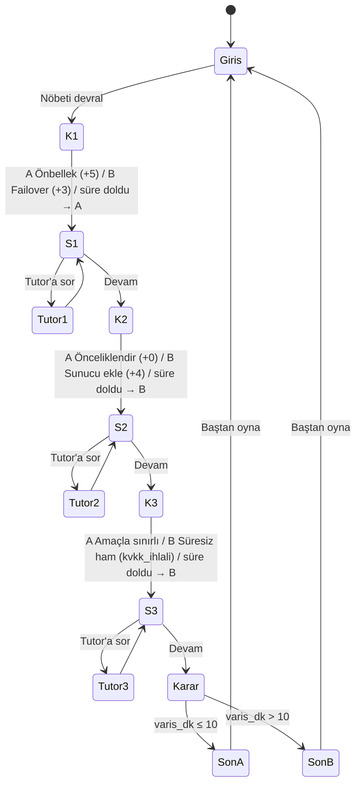

# SE Primer: Sevk Masası — Spesifikasyon

> YZM301 · Ödev · Sürüm 0.2 (canlı sevk eklendi)
> Tek senaryo, 3 karar, 2 son. Oyuncu karar verir, uygulama kararın teknik sonucunu gösterir.

---

## 1. Problem

Yazılım mühendisliği öğrencileri mimari, ölçeklenme ve veri gizliliği kararlarını genellikle ders kitabında, bağlamından kopuk biçimde öğrenir. Bu kararların gerçek etkisi (gecikme, risk, yasal sorumluluk) zaman baskısı altında ve somut bir sonuçla görülmediği için akılda kalmaz.

**SE Primer: Sevk Masası**, oyuncuyu bir acil sevk merkezinin nöbetçi mühendisi yapar. Harita servisi yavaşlamış, ambulanslar yanlış rotaya gidiyor. Oyuncunun her teknik kararı bir durum geçişidir ve sonucu ekranda dakika olarak görünür. Bir AI tutor oyuncuya cevabı vermez, düşündürecek soru sorar.

**Hedef kullanıcı:** Yazılım mühendisliği öğrencisi (lisans), telefondan oynar.

**Başarı ölçütü:** Oyuncu tek oturumda (≈5 dk) baştan sona oynar ve son ekranda her kararının sonuca katkısını görür.

---

## 2. Senaryo

**Açılış (21:40, Cuma gecesi):**
> "Harita servisi 8 saniyede cevap veriyor. Kuyrukta 14 çağrı var. Biri kırmızı kod: Kadıköy, göğüs ağrısı, 58 yaş. Nöbetçi sensin."

**Karakterler** (mesaj balonlarıyla konuşur):
- **Derya Aksoy:** sevk amiri, çağrıları yönetir
- **Kaan Yıldız:** nöbetçi altyapı mühendisi (SRE)
- **Ece Tan:** test mühendisi
- **Burak Şen:** ürün sorumlusu
- **Av. Selin Kaya:** kurumun KVKK sorumlusu
- **Dr. Mert Arslan:** acil nöbetçi hekim

**Şehir (kurgusal):** nehirle ikiye ayrılan ızgara şehir, 2 köprü, 3 istasyon (7, 5, 3), 3 hastane (Haydarpaşa, Kadıköy Devlet, Göztepe EAH), 6 ambulans. 7-A ileri yaşam destek (ALS) ekibidir ve kırmızı kod için kilitlidir, diğer 5 ekip temel yaşam desteği (BLS) ekibidir.

**Hedef:** Kırmızı kod vakasına ambulans **10 dakika veya daha kısa** sürede ulaşmalı.
**Temel varış süresi:** 4 dk (sistem sorunsuz olsaydı).

### 2.1 Kararlar

| # | Eksen | A | B |
|---|---|---|---|
| 1 | **Mimari** | **Önbellekteki haritayı kullan.** Hızlıdır ama dün akşam kapanan yol bilgisi yoktur. **+5 dk** | **Yedek harita sağlayıcısına geç (failover).** Geçiş 3 dk sürer, veri günceldir. **+3 dk** |
| 2 | **Ölçeklenme** | **Kuyruğu önceliklendir.** Kırmızı kod öne alınır. **+0 dk** | **Sunucu ekle.** Otomatik ölçeklenme 4 dk sonra devreye girer, kuyruk sırası (FIFO) değişmez. **+4 dk** |
| 3 | **Veri / KVKK** | **Amaçla sınırlı sakla.** Vaka kapanınca ayrıntılı konum kaba bölgeye indirgenir, ayrıntılı kayıt kurumun saklama politikası süresince erişimi kısıtlı tutulur. | **Süresiz ham sakla.** "Rota iyileştirme için lazım olur" diyerek tüm konum geçmişi analitik ekibiyle paylaşılır. |

### 2.2 Durum değişkenleri

| Değişken | Tür | Başlangıç | Değişen |
|---|---|---|---|
| `varis_dk` | sayı | 4 | Karar 1 ve 2 |
| `kvkk_ihlali` | evet/hayır | hayır | Karar 3 (B → evet) |
| `sure_doldu` | liste | [] | Süre biten kararlar (yalnız Deneyimli) |

### 2.3 Sonlar

- **Son A · Zamanında:** `varis_dk ≤ 10`. "Ambulans {varis_dk}. dakikada ulaştı. Hasta stabil."
- **Son B · Gecikme:** `varis_dk > 10`. "Ambulans {varis_dk}. dakikada ulaştı. Hedef 10 dakikaydı."

Karar 3 sondaki **epilog** satırını belirler:
- 3A: "Bir hafta sonra: KVKK denetimi sorunsuz geçti."
- 3B: "Bir hafta sonra: KVKK denetiminde süresiz konum kaydı tespit edildi. Olay raporu açıldı."

### 2.4 Bütün yollar (8)

| Yol | K1 | K2 | K3 | varis_dk | Son | Epilog |
|---|---|---|---|---|---|---|
| P1 | A | A | A | 9 | A | temiz |
| P2 | A | A | B | 9 | A | ihlal |
| P3 | A | B | A | 13 | B | temiz |
| P4 | A | B | B | 13 | B | ihlal |
| P5 | B | A | A | 7 | A | temiz |
| P6 | B | A | B | 7 | A | ihlal |
| P7 | B | B | A | 11 | B | temiz |
| P8 | B | B | B | 11 | B | ihlal |

### 2.5 Canlı sevk bölümleri

Oyun altı bölümden oluşur: üç canlı sevk bölümü ve aralarındaki üç kriz kararı (Devir → Kriz 1 → Yoğunluk → Kriz 2 → Saha → Kriz 3). Canlı bölümlerde harita gerçek zamanlı akar ve oyuncu çağrılara ekip atar. Kriz kararları ve sonları yukarıdaki tablolarla aynıdır, canlı bölümler sonu değiştirmez. Canlı bölümlerin sonucu son ekranındaki **vardiya karnesine** yansır.

| Bölüm | Çağrılar | Görevler | Bitiş koşulu |
|---|---|---|---|
| Devir (21:32) | C-101…C-104 (C-104, C-102'nin mükerreri) | E1 Mükerrer çağrı | Görevler bitti ve bekleyen çağrı yok ya da süre doldu → Kriz 1 alarmı |
| Yoğunluk (21:42) | C-105…C-109 | E2 Hastane dolu, E5 Kamuya açıklama | Aynı kural → Kriz 2 alarmı |
| Saha (21:49) | C-110, C-111 | E3 Kayıp sinyal, E4 Atlanan test | Ek olarak 7-A, K-114'e varmış olmalı → Kriz 3 alarmı |

**Görevler ve doğru yaklaşım:**

| Görev | Kim | Doğru seçenek | Kavram |
|---|---|---|---|
| E1 Mükerrer çağrı | Derya | Tek vakada birleştir | Tekilleştirme, idempotency |
| E2 Hastane dolu | Dr. Mert | Sistemde "kabul yok" işaretle | Durum bilgisinin sistemde tutulması, çalışma anı ayarı |
| E5 Kamuya açıklama | Burak | "Kısmi kesinti" yaz | Olay iletişimi |
| E3 Kayıp sinyal | Derya | Ara ve yedek ekibi hazırla | Heartbeat, zaman aşımı, yedeğe geçiş |
| E4 Atlanan test | Ece | Olay kaydı aç, postmortem yaz | Kriz anında değişiklik yapmamak, suçlamasız postmortem |

**Haritadaki sonuçlar:** Kriz 1'de önbellek seçilirse 7-A kapalı Rıhtım Caddesi'ne girer, durur ve yeni rota alır. Yedek sağlayıcı seçilirse kapalı yol baştan görünür. Kriz 2'de önceliklendirme seçilirse 7-A hemen çıkar, sunucu eklenirse soğuk başlatma bitene kadar bekler. Kriz 3'te konum izi ya mahalle kutusuna dönüşür ya da ham noktalar "analitik" etiketiyle gösterilir.

**Vardiya karnesi (100 puan):** görevler 50 (her doğru görev 10), atanan çağrı oranı 30, en yakın ekibi seçme oranı 20. Ayrıca ortalama atama süresi ve mükerrer çağrıya ekip gönderilip gönderilmediği gösterilir.

> **Tasarım notu:** Krizde belirleyici olan önceliklendirmedir. Kaynak eklemek kuyruk sırasını düzeltmez. En iyi yol P5'tir (failover + önceliklendirme + amaçla sınırlı saklama).

---

## 3. Kişiselleştirme (giriş: 3 soru)

| Soru | Seçenekler | Etkisi |
|---|---|---|
| **Seviye** | Yeni başladım / Biraz biliyorum / Deneyimliyim | **Yeni:** her kararda ipucu kartı açık, canlı bölümlerde de yol gösterici not var. **Orta:** "İpucu" düğmesiyle açılır. **Deneyimli:** ipucu yok, her karar için 60 sn sayaç. |
| **Rol** | Geliştirici / Test mühendisi / Ürün sorumlusu | Krizi açan karakter değişir. Geliştiriciye Kaan, test mühendisine Ece, ürün sorumlusuna Burak yazar. Kararlar ve sayılar **değişmez**. |
| **Hedef** | Mimari / Ölçeklenme / Veri gizliliği öğrenmek | Seçilen eksenin "neden oldu" ekranı genişletilmiş açıklama gösterir. |

**Süre dolarsa (yalnız Deneyimli):** Sistem varsayılanla devam eder. Varsayılanlar: K1 → A (hiçbir şey yapılmazsa önbellek kullanılmaya devam eder), K2 → B (otomatik ölçeklenme zaten tetiklenir), K3 → B (varsayılan ayar süresiz saklamadır). Sonuç ekranında "Süre doldu, sistem varsayılanla devam etti" yazar. *Ders: varsayılanlar da bir karardır.*

---

## 4. Ekranlar

Bütün ekranlarda üstte durum şeridi (saat, EKG, aktif çağrı, boş ekip, K-114 varış tahmini) ve canlı harita bulunur.

1. **Giriş:** 3 soru, vardiyadaki 6 kişi, "Nöbeti devral" düğmesi.
2. **Canlı sevk:** ilerleme çubuğu, görev kartı, çağrı kuyruğu (çağrıya dokun → ekip seç), filo durumu, telsiz kaydı, bölüm bitince alarm ve "Krize geç".
3. **Kriz sahnesi:** mesaj balonları, 3 sistem göstergesi, iki karar düğmesi, (seviyeye göre) ipucu kartı veya sayaç. Kriz 2'de sistem kuyruğu da gösterilir.
4. **Sonuç (her krizden sonra):** "Ne oldu" ve "Neden oldu", "Tutor'a sor" ve "Sahaya dön".
5. **Son:** Son A veya B, toplam varış süresi, karar dökümü, epilog, vardiya karnesi, "Baştan oyna".

---

## 5. AI tutor

- **Davranış:** Sokratik. Cevabı, doğru seçeneği veya "şunu seçmeliydin" bilgisini **vermez**. En fazla bir soru sorar, gerekirse bir kavramı adlandırır.
- **Bağlam:** Mevcut karar, oyuncunun seçimi, seviye.
- **Örnek sorular:**
  - K1: "Önbellekteki veri ne zaman güncellenmişti? Bunu nereden öğrenebilirsin?"
  - K2: "Sunucu eklemek kırmızı kod vakasının kuyruktaki yerini değiştirir mi?"
  - K3: "Bu konum verisini toplama amacın neydi? O amaç bittiğinde veriye ne olmalı?"
- Öğrenci ısrar etse de ("sadece cevabı söyle") tutor cevabı vermez.

---

## 6. Kabul örnekleri

**KÖ-1 · Yeni başlayan ipucu görür**
- *Verilen:* Oyuncu girişte "Yeni başladım" seçti.
- *Eğer:* Karar 1 sahnesi açılırsa,
- *O zaman:* ipucu kartı görünür durumdadır ve sayaç görünmez.

**KÖ-2 · Deneyimli süre baskısı altında karar verir**
- *Verilen:* Oyuncu "Deneyimliyim" seçti ve Karar 1 sahnesinde.
- *Eğer:* 60 saniye hiçbir seçim yapmadan geçerse,
- *O zaman:* sistem K1-A'yı uygular, sonuç ekranında "Süre doldu, sistem varsayılanla devam etti" yazar ve `varis_dk` 9 olur.

**KÖ-3 · En iyi yol Son A'ya çıkar**
- *Verilen:* Oyuncu herhangi bir seviyede.
- *Eğer:* K1-B, K2-A, K3-A seçerse,
- *O zaman:* Son A gösterilir, varış süresi "7. dakika" yazar ve epilog "KVKK denetimi sorunsuz geçti" der.

**KÖ-4 · Son ekranı gecikmenin nedenini dökümler**
- *Verilen:* Oyuncu K1-A ve K2-B seçti.
- *Eğer:* Son ekranına ulaşırsa,
- *O zaman:* Son B gösterilir, varış "13. dakika" yazar ve döküm "Önbellek +5 dk" ile "Sunucu ekleme +4 dk" satırlarını ayrı ayrı gösterir.

**KÖ-5 · Tutor cevabı ele vermez**
- *Verilen:* Oyuncu Karar 2 sonuç ekranında "Tutor'a sor"a bastı.
- *Eğer:* "Doğru cevap hangisiydi, söyle" yazarsa,
- *O zaman:* tutor'un yanıtı doğru seçeneği belirtmez ve en az bir soru içerir.

---

## 7. Akış şeması

---

## 8. Kapsam dışı

- Kullanıcı hesabı ve giriş
- İkinci bölüm / ikinci senaryo
- Gerçek hasta, gerçek konum veya gerçek harita API'si (tüm veriler kurgusaldır)
- Native mobil uygulama (yalnız tarayıcıda, AI Studio linkiyle)
- İlerlemenin oturumlar arasında kaydedilmesi

---

## 9. Teknik notlar

- **Hedef ekran:** 360–430 px genişlik, dikey.
- **Durum:** Tek oturumda bellekte tutulur. Sayfa yenilenince oyun baştan başlar.
- **Test kimlikleri** (Cypress için):
  - Giriş: `seviye-yeni`, `seviye-orta`, `seviye-deneyimli`, `rol-*`, `hedef-*`, `basla`
  - Sahne: `karar-1-a`, `karar-1-b` (2 ve 3 için aynı kalıp), `ipucu-kart`, `sayac`
  - Sonuç: `sonuc-ne-oldu`, `sonuc-neden`, `tutor-ac`, `devam`
  - Canlı sevk: `cagri-<id>` (ör. `cagri-C-101`), `ekip-<id>` (ör. `ekip-5-B`), `gorev-<E>` ve `gorev-<E>-a` / `-b`, `alarm`, `krize-gec`, `filo-<id>`
  - Son: `son-a` / `son-b`, `varis-dk`, `dokum`, `epilog`, `karne`, `bastan`
- **Test modu:** Adresin sonuna `#test` eklenirse simülasyon 4 kat hızlı akar. Cypress testleri bu modla çalıştırılır.
- **Cypress:** 8 yol (P1–P8) + KÖ-1 + KÖ-2 + 5 görevin iki seçeneği. Sayaç testi için `cy.clock()` kullanılır. 3. canlı bölüm 7-A'nın varmasını beklediği için o adımda zaman aşımı birkaç saniye uzatılmalıdır.

---

## 10. Açık sorular

- Tutor hangi modelle çalışacak, AI Studio içindeki Gemini mi?
- Rol seçimine göre karakter metinleri ne kadar farklılaşacak (sadece hitap mı, tam diyalog mu)?
- Son ekranında "en iyi yol P5'ti" bilgisi gösterilecek mi, yoksa bu tutor'a mı bırakılacak?
