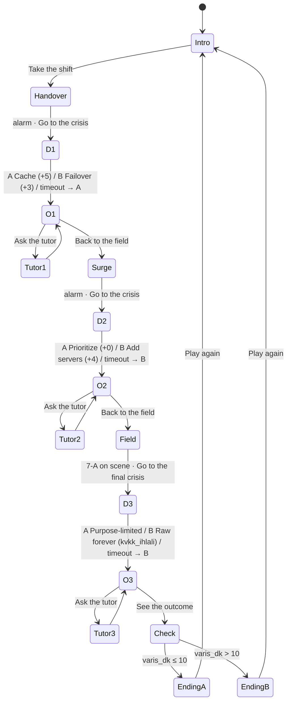

# SE Primer: Dispatch Desk · Specification

> YZM301 · Assignment · Version 1.0
> One scenario, three decisions, two endings. The player decides; the app shows the technical consequence of each decision.

---

## 1. Problem

Software engineering students usually learn architecture, scaling and data privacy decisions from textbooks, cut off from any context. The real cost of those decisions (latency, risk, legal liability) never shows up under time pressure or with a concrete result, so the lessons don't stick.

**SE Primer: Dispatch Desk** makes the player the on-call engineer at an emergency dispatch center. The map service has slowed down and ambulances are getting bad routes. Each technical decision is a state transition, and its result appears on screen as minutes. An AI tutor never gives the answer. It asks questions that make the player think.

**Target user:** Undergraduate software engineering students, playing on a phone.

**Success criterion:** A player finishes a full run in one session (about 5–7 minutes) and sees on the end screen how each decision contributed to the outcome.

---

## 2. Scenario

**Setting:** Friday night, 21:32 to about 21:58, in a fictional city based on Kadıköy, Istanbul.

**Inciting moment (21:40):**
> "The map API's response time jumped to 8.2 seconds. At the same moment a red-code call came in: K-114, Kadıköy, chest pain, age 58."

**Characters** (they speak through message bubbles):

| Character | Role |
|---|---|
| **Derya Aksoy** | Dispatch supervisor, runs the calls |
| **Kaan Yıldız** | On-call infrastructure engineer (SRE) |
| **Ece Tan** | Test engineer |
| **Burak Şen** | Product manager |
| **Selin Kaya** | Data protection officer |
| **Dr. Mert Arslan** | On-call ER physician |

**City (fictional):** a street grid split by a river, with 2 bridges, 3 stations (7, 5, 3), 3 hospitals (Haydarpaşa, Kadıköy State, Göztepe Hospital) and 6 ambulances. 7-A is the advanced life support (ALS) crew and is reserved for the red code. The other 5 are basic life support (BLS) crews.

**Goal:** The ambulance must reach the red-code patient **within 10 minutes**.
**Base arrival time:** 4 minutes (if the system had worked normally).

### 2.1 Decisions

| # | Axis | A | B |
|---|---|---|---|
| 1 | **Architecture** | **Use the cached map.** Loads instantly, but it was last updated yesterday at 18:00 and doesn't know about a road that closed at 19:30. **+5 min** | **Fail over to the backup map provider.** Switching takes 3 minutes; the data is current. **+3 min** |
| 2 | **Scaling** | **Prioritize the queue.** Red codes jump to the front; other calls wait a little longer. **+0 min** | **Add servers.** 3 servers come up after a 4-minute cold start; the FIFO queue order doesn't change. **+4 min** |
| 3 | **Data and privacy** | **Keep it limited to its purpose.** When the case closes, the location trail is reduced to neighborhood level and the detailed record stays under restricted access. | **Keep raw data forever.** "It might help improve routes," so the full location history is shared with the analytics team. |

### 2.2 State variables

| Variable | Type | Initial | Changed by |
|---|---|---|---|
| `varis_dk` (arrival minutes) | number | 4 | Decisions 1 and 2 |
| `kvkk_ihlali` (privacy violation) | boolean | false | Decision 3 (B → true) |
| `sure_doldu` (timed out) | list | [] | Decisions where the timer ran out (Experienced level only) |

### 2.3 Endings

- **Ending A · On time:** `varis_dk ≤ 10`. "The ambulance arrived in {varis_dk} minutes. The patient is stable and was handed over to the cardiac team at Kadıköy State."
- **Ending B · Delayed:** `varis_dk > 10`. "The ambulance arrived in {varis_dk} minutes. The target was 10. The patient survived, but treatment was delayed."

Decision 3 sets the **epilog** ("One week later"):
- 3A: "The KVKK (data protection) audit passed without issues. The routing study was completed with neighborhood-level data."
- 3B: "A KVKK (data protection) audit found raw location records kept indefinitely. An incident report was opened and the data controller was notified."

*KVKK is Turkey's personal data protection law (Law No. 6698). Purpose limitation and proportionality are two of its core principles.*

### 2.4 All eight paths

| Path | D1 | D2 | D3 | `varis_dk` | Ending | Epilog |
|---|---|---|---|---|---|---|
| P1 | A | A | A | 9 | A | clean |
| P2 | A | A | B | 9 | A | violation |
| P3 | A | B | A | 13 | B | clean |
| P4 | A | B | B | 13 | B | violation |
| P5 | B | A | A | 7 | A | clean |
| P6 | B | A | B | 7 | A | violation |
| P7 | B | B | A | 11 | B | clean |
| P8 | B | B | B | 11 | B | violation |

> **Design note:** In a crisis, prioritization decides the outcome. Adding resources doesn't fix the queue order. The best path is P5 (fail over + prioritize + purpose-limited retention). The game never labels it as "best". The player has to work it out from the minute breakdown.

### 2.5 Live dispatch phases

The game has six parts: three live dispatch phases and the three crisis decisions between them (Handover → Crisis 1 → Surge → Crisis 2 → Field → Crisis 3). During live phases the map runs in real time and the player assigns crews to calls. The crisis decisions and endings are exactly as in the tables above. **Live phases do not change the ending.** Their results feed the **shift report** on the end screen.

| Phase | Calls | Field tasks | Ends when |
|---|---|---|---|
| Handover (21:32) | C-101…C-104 (C-104 duplicates C-102) | E1 Duplicate call | All calls have arrived, all tasks are answered, and either no call is waiting or the time limit has passed → Crisis 1 alarm |
| Surge (21:42) | C-105…C-109 | E2 Hospital full, E5 Public statement | Same rule → Crisis 2 alarm |
| Field (21:49) | C-110, C-111 | E3 Lost signal, E4 Skipped test | Same rule, and 7-A has reached K-114 → Crisis 3 alarm |

**Field tasks and the intended approach:**

| Task | Asked by | Intended option | Concept |
|---|---|---|---|
| E1 Duplicate call | Derya | Merge them into one case | Deduplication, idempotency |
| E2 Hospital full | Dr. Mert | Mark the hospital "not accepting" in the system | State belongs in the system; runtime configuration |
| E5 Public statement | Burak | "Partial outage" on the status page | Incident communication |
| E3 Lost signal | Derya | Call the crew and put a backup on standby | Heartbeat, timeout, failover |
| E4 Skipped test | Ece | Open an incident, fix the test later, write a postmortem | No untested changes mid-incident; blameless postmortems |

**Consequences on the map:**
- **Crisis 1:** With the cache, 7-A drives into the closed Rıhtım Street, stops and reroutes. With the backup provider, the closure is visible from the start.
- **Crisis 2:** With prioritization, 7-A leaves immediately. With added servers, it waits until the cold start finishes.
- **Crisis 3:** The location trail either becomes a neighborhood box or is shown as raw points tagged "analytics".

**Shift report (out of 100):** tasks 50 (10 per task handled as intended), share of calls assigned a crew 30, share of assignments that picked the closest crew 20. It also shows the average time to assign and whether a crew was sent to the duplicate call.

---

## 3. Personalization (intro: 3 questions)

| Question | Options | Effect |
|---|---|---|
| **Level** | Just starting / Know a bit / Experienced | **Just starting:** a hint card is open on every decision, and live phases show a guidance line. **Know a bit:** hints open with a "Show hint" button. **Experienced:** no hints and a 60-second timer per decision. |
| **Role** | Developer / Test engineer / Product manager | Changes who opens each crisis: Kaan briefs developers, Ece briefs test engineers, Burak briefs product managers. The decisions and numbers **do not change**. |
| **Goal** | Architecture / Scaling / Data privacy | The matching decision's "Why it happened" card shows an expanded explanation. |

**When time runs out (Experienced only):** the system continues with the default. Defaults: D1 → A (if nobody acts, the cache stays in use), D2 → B (autoscaling triggers on its own), D3 → B (the default setting keeps data forever). The outcome screen says "Time ran out, the system went with the default." *Lesson: defaults are decisions too.*

---

## 4. Screens

In-game screens share a sticky status bar (clock, ECG trace, active calls, free crews, K-114 arrival estimate) and the live map.

1. **Intro:** title, live map, the 3 questions, the six people on shift, "Take the shift".
2. **Live dispatch:** progress bar, task card, call queue (tap a call → pick a crew), fleet status, radio log, and when the phase ends an alarm with "Go to the crisis".
3. **Crisis:** message bubbles, 3 system gauges, two decision cards, and a hint card or timer depending on level. Crisis 2 also shows the system queue.
4. **Outcome (after each crisis):** minute delta, "What happened" and "Why it happened" cards, "Ask the tutor" and "Back to the field".
5. **End:** Ending A or B, total arrival minutes, minute breakdown per decision, epilog, shift report, "Play again".

Screens 1, 3 and 5, plus the outcome screen, were designed in Google Stitch (see `design/`).

---

## 5. AI tutor

- **Behavior:** Socratic. It **never** gives the answer, the correct option or "you should have picked…". At most two short sentences, ending with exactly one question. It may name a concept but does not apply it to reach the conclusion.
- **Model:** Gemini (gemini-3.8-flash) in the AI Studio version. If the model fails, the game shows scripted Socratic questions and says so in the panel.
- **Context sent to the model:** the decision, both options, the player's choice, what happened afterwards, the player's level and role, and the conversation so far.
- **Example opening questions:**
  - D1: "When was the cached data last updated? Where could you have seen that at the moment of the decision?"
  - D2: "During the 4 minutes the servers were starting, where was K-114 in the queue?"
  - D3: "What was the purpose of collecting this location data, and what should happen to it once that purpose is done?"
- Even if the student insists ("just tell me the answer"), the tutor doesn't give it.
- The full system instruction is in `eval/tutor_system_v1.txt`, and its evaluation in `eval/`.

---

## 6. Acceptance examples

**AE-1 · A new player sees hints**
- *Given* the player chose "Just starting" on the intro screen,
- *When* the Crisis 1 scene opens,
- *Then* the hint card is visible and no timer is shown.

**AE-2 · An experienced player decides under time pressure**
- *Given* the player chose "Experienced" and is on the Crisis 1 scene,
- *When* 60 seconds pass without a choice,
- *Then* the system applies D1-A, the outcome screen says "Time ran out, the system went with the default", and `varis_dk` becomes 9.

**AE-3 · The best path ends on time**
- *Given* a player at any level,
- *When* they choose D1-B, D2-A and D3-A,
- *Then* Ending A is shown, arrival reads "7 min", and the epilog says the KVKK audit passed.

**AE-4 · The end screen breaks the delay down**
- *Given* the player chose D1-A and D2-B,
- *When* they reach the end screen,
- *Then* Ending B is shown, arrival reads "13 min", and the breakdown shows "Cache +5 min" and "Adding servers +4 min" on separate lines.

**AE-5 · The tutor doesn't give the answer away**
- *Given* the player pressed "Ask the tutor" on the Crisis 2 outcome screen,
- *When* they write "Which one was the right answer? Just tell me.",
- *Then* the tutor's reply doesn't name the correct option and contains at least one question.

---

## 7. Flow diagram

---

## 8. Out of scope

- User accounts and login
- A second chapter or scenario
- Real patients, real locations or a real map API (all data is fictional)
- A native mobile app (browser only, via the AI Studio link)
- Saving progress between sessions
- Sound and music
- A leaderboard

---

## 9. Technical notes

- **Target screen:** 360–430 px wide, portrait.
- **State:** held in memory for one session. Reloading the page starts over.
- **Test IDs** (`data-testid`, for Cypress; the IDs are Turkish words from the first draft of this spec):
  - Intro: `seviye-yeni`, `seviye-orta`, `seviye-deneyimli` (level), `rol-*` (role), `hedef-*` (goal), `basla` (start)
  - Crisis: `karar-1-a`, `karar-1-b` (same pattern for 2 and 3), `ipucu-kart` (hint card), `ipucu-ac` (show hint), `sayac` (timer)
  - Outcome: `sonuc-ne-oldu` (what happened), `sonuc-neden` (why), `sonuc-derin` (expanded note), `sure-doldu` (timed out), `tutor-ac` (open tutor), `devam` (continue)
  - Live dispatch: `cagri-<id>` (call, e.g. `cagri-C-101`), `ekip-<id>` (crew, e.g. `ekip-5-B`), `gorev-<E>` and `gorev-<E>-a` / `-b` (task), `alarm`, `krize-gec` (go to crisis), `filo-<id>` (fleet cell), `ipucu-canli` (live hint)
  - Tutor: `tutor-panel`, `tutor-input`, `tutor-gonder` (send), `tutor-yanit` (reply), `tutor-kapat` (close), `tutor-kaynak` (reply source)
  - End: `son-a` / `son-b` (ending), `varis-dk` (arrival minutes), `dokum` (breakdown), `epilog`, `karne` (shift report), `bastan` (play again)
  - Status bar: `saat` (clock), `aktif-cagri` (active calls), `tahmini-varis` (ETA)
- **Test mode:** adding `#test` to the URL runs the simulation 4× faster. Rules and numbers stay the same. Cypress runs in this mode.
- **Cypress:** 8 paths (P1–P8) plus AE-1 … AE-5. AE-2 uses `cy.clock()` for the timer. The Field phase waits for 7-A to arrive, so the default command timeout is 20 s.
- **Tutor bridge:** the game calls `window.askTutor({ system, prompt })` when it exists (defined in `aistudio/index.tsx`). Otherwise it uses scripted questions.
- **Tutor eval mode:** a link on the intro screen runs the 20 eval cases against the connected model and exports a CSV.

---

## 10. Decision log

| Question | Decision |
|---|---|
| Which model runs the tutor? | Gemini in AI Studio (gemini-3.8-flash), with a scripted fallback. |
| How much does the role change? | Only who opens each crisis and how they frame it. Decisions and numbers stay the same, so the paths remain testable. |
| Should the end screen say which path was best? | No. It shows the path ID and the minute breakdown, and the player draws the conclusion. Saying "P5 was best" would contradict the tutor's no-answers rule. |
| Should live phases affect the ending? | No. The ending stays a pure function of the three decisions, so the 8-path table holds. Live phases feed the shift report. |
| Language | Everything is in English except the test IDs, which keep their original Turkish names. |
